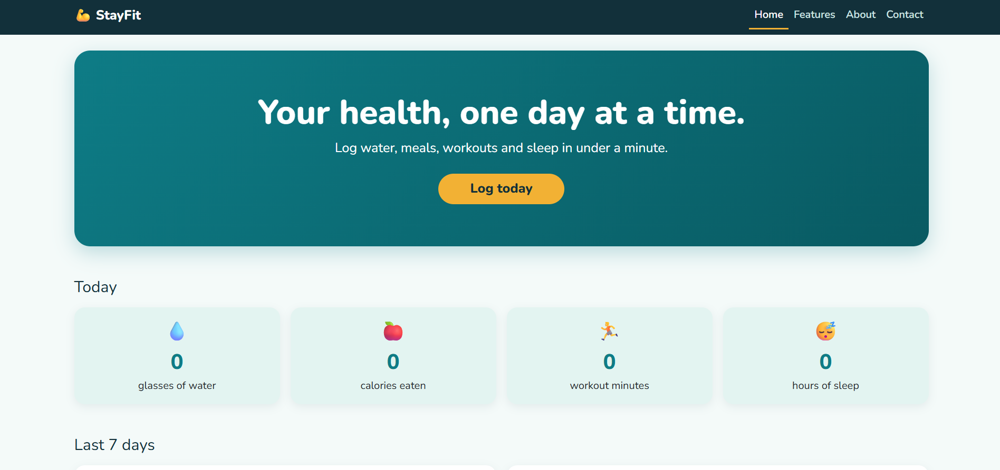
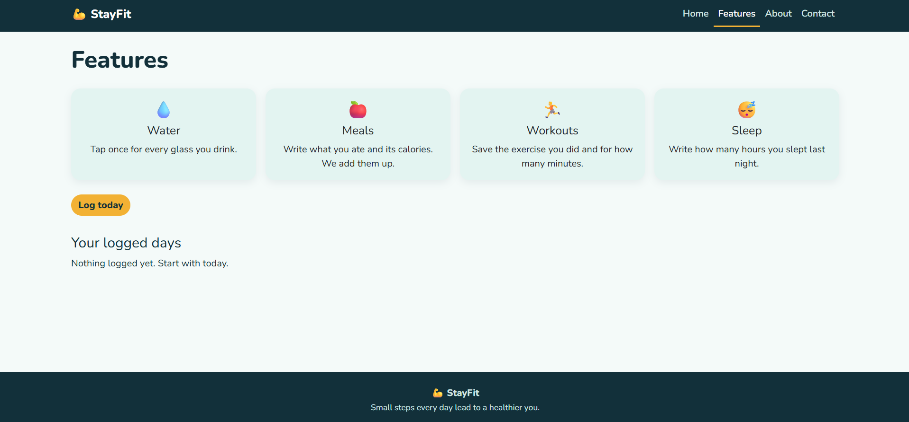
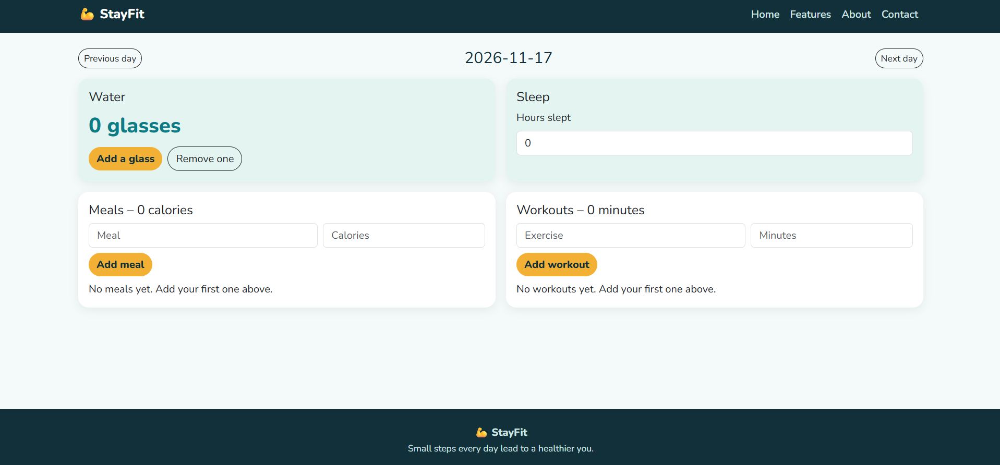
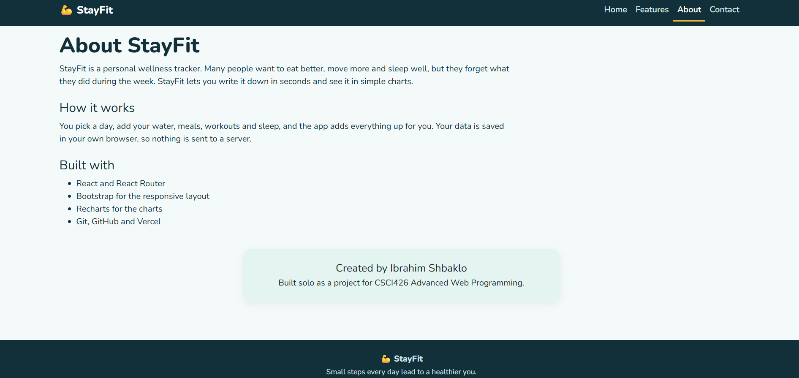
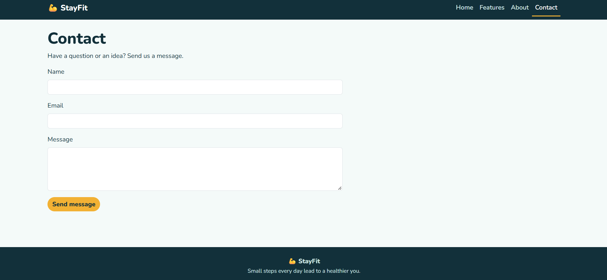
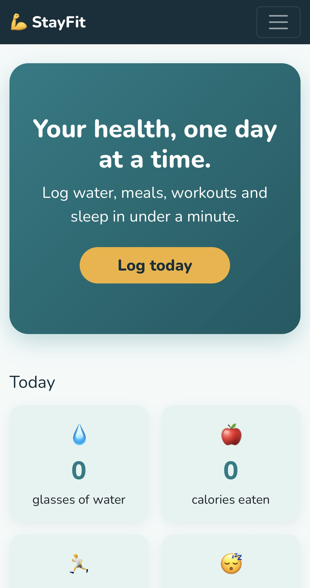

# StayFit 💪

**StayFit** is a simple wellness tracker website. Every day you can write down how much water you drank, what you ate, how long you exercised and how many hours you slept. The app adds everything up for you and shows it in easy charts.

- **Live website:** https://stayfit-ib.vercel.app/
- **GitHub repository:** https://github.com/IbrahimShba/stayfit

**Built for:** CSCI426 Advanced Web Programming, Section C, Fall 2026 (Project Phase 1, theme: HealthTrack, a fitness and wellness tracking website)
**Group statement:** I worked alone on this project (no group).

---

## Project Description

Many people want to eat better, move more and sleep well, but they forget what they did during the week. StayFit solves this: you pick a day, add your water, meals, workouts and sleep, and the app shows your totals and two 7-day charts.

There is no server and no login. All data is saved in the user's own browser (localStorage), so it stays after a page refresh.

## Features

- Log water (glasses), meals (with calories), workouts (with minutes) and sleep (hours) for any day
- Home page with today's numbers and two 7-day bar charts (calories and workout minutes)
- Features page with a list of all the days you logged
- About and Contact pages
- Responsive design: works on desktop and on mobile (with a mobile menu button)
- Data saved in the browser with localStorage

## Pages

| Page | Link | Description |
|------|------|-------------|
| Home | `/` | Hero section, today's stats and 7-day charts |
| Features | `/features` | The four things you can track and the list of logged days |
| About | `/about` | What the app is, how it works and who made it |
| Contact | `/contact` | Contact form (shows a thank-you message, no server) |
| Day Log (dynamic page) | `/log/:date` | Add or edit one day, for example `/log/2026-11-17` |

The **Day Log** page is the dynamic page: it reads the date from the link with `useParams` and shows that day's data.

## Technologies and Libraries Used

- [React](https://react.dev/) (built with [Vite](https://vite.dev/)): the main library for the user interface
- [React Router](https://reactrouter.com/): moves between pages without reloading and reads the date from the link
- [Bootstrap](https://getbootstrap.com/): responsive grid, navbar, cards and buttons
- [Recharts](https://recharts.org/): the bar charts
- localStorage (built into the browser): saves the data
- Git and GitHub: version control
- Vercel: hosting

The design styles (colors, hero section, cards) are in `src/index.css`. No pre-built website template was used. The libraries above are cited as required.

## Setup Instructions

You need [Node.js](https://nodejs.org/) installed.

1. Download or clone the project:
   ```
   git clone https://github.com/IbrahimShba/stayfit.git
   ```
2. Go into the project folder:
   ```
   cd stayfit
   ```
3. Install the packages:
   ```
   npm install
   ```
4. Start the app:
   ```
   npm run dev
   ```
5. Open the link shown in the terminal (usually http://localhost:5173).

To make a production build, run `npm run build`.

## Project Structure

```
stayfit/
├── index.html            the single HTML page
├── vercel.json           makes page links work after refresh on Vercel
├── screenshots/          the images used in this README
└── src/
    ├── main.jsx          starting file: loads React, Bootstrap and the router
    ├── App.jsx           keeps all the data (logs), saves it, and shows the right page
    ├── utils.js          small helper functions (dates and totals)
    ├── index.css         colors and custom styles
    ├── components/
    │   ├── Navbar.jsx    top menu bar
    │   └── Footer.jsx    bottom bar
    └── pages/
        ├── Home.jsx
        ├── Features.jsx
        ├── About.jsx
        ├── Contact.jsx
        └── DayLog.jsx    the dynamic page
```

## Screenshots

### Home (desktop)


### Features


### Day Log (dynamic page)


### About


### Contact


### Mobile view


## Version Control

The project was built step by step with Git. The commit history on GitHub shows each stage: project setup, styles and helpers, navbar and footer, the pages, and the dynamic day log page.

## Credits

- React, React Router, Bootstrap and Recharts are open-source libraries (links above).
- Font: Nunito from Google Fonts.

---

## Author

**Ibrahim Shbaklo** — CSCI426 Advanced Web Programming